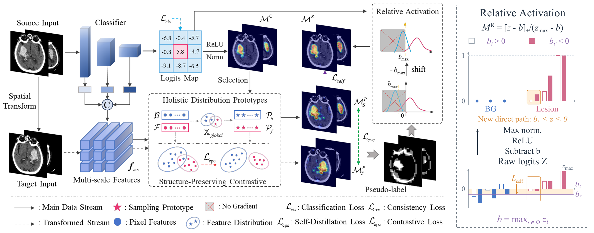

# Horizon

**Resolving Logits Adhesion for Weakly Supervised Intracranial Hemorrhage Segmentation**

Caozhi Shang, Xian Lin, Junjie Shi, Zengqiang Yan, Xianbo Deng, and Li Yu

Horizon learns to localize intracranial hemorrhage on non-contrast head CT using a binary label for each training slice. A classifier can correctly identify a positive slice while assigning similar scores to a subtle bleed and nearby normal tissue. The manuscript calls this overlap between their pixel-wise logit distributions **logits adhesion**. Horizon uses the feature distributions of hemorrhage and normal tissue to teach the classifier which local responses to raise or suppress.

This PyTorch release includes Horizon with SPOL and Swin-MIL backbones, both standalone baselines, an RSNA training entry point, and slice-level inference for INSTANCE and BHSD.

## How Horizon works



**Horizon training framework and relative activation.** Left, manuscript Figure 3 traces the two CT views through the classifier and prototype bank to the activation maps used for training. Right, the companion diagram expands the relative activation step. The orange box tracks one lesion pixel whose negative logit becomes active when the background reference falls below it.

1. **Model the feature distributions.** Holistic Distribution Prototypes (HDPs) use class-specific feature queues and Gaussian distributions. Sampling from them provides multiple examples of what hemorrhage and normal tissue can look like in feature space.
2. **Learn which features belong together.** Structure-Preserving Contrastive Learning (SPC) separates the two classes while allowing different normal structures to match different background prototypes. The **Prototype Activation Map (PAM)** measures the positive margin between the best foreground and background similarities. Cross-view consistency encourages corresponding locations to retain similar PAM values after a flip.
3. **Transfer that evidence to the classifier.** The PAM provides a continuous, detached target for the **Relative Activation Map (RAM)**. Pixel-wise self-distillation encourages the classifier’s raw spatial logits to preserve the separation already present in the feature space. The main segmentation experiments use the classifier CAM at inference.

### How the training signal reaches the logits


**Figure 4 (manuscript). Logit calibration and gradient flow.** Red arrows indicate gradient directions; dashed blue segments indicate blocked gradients. In the Horizon panel, the orange lines mark the old and updated background reference. The schematic below follows those updates across a lesion and its surrounding tissue.


**Reading the four panels.** The pink band marks the lesion and the blue curve traces the current response. Erasing hides a strong response to expose another part of the lesion. CAM calibration adjusts the response using a guide. Fitting a binary pseudo-label can also reinforce an erroneous foreground target, illustrated by the isolated target on the right of panel (c). In panel (d), prototype evidence supplies a graded target. The arrows show how an underestimated lesion response can rise while the strongest competing background response falls. These curves illustrate the mechanism.

### Why a relative reference helps

In the right-hand panel beside Figure 3, read the raw logits at the bottom and their relative activations at the top. For spatial logit $z_i$, the manuscript defines $b$ as the largest logit among locations where background-prototype similarity exceeds hemorrhage-prototype similarity. Subtracting $b$ before rectification makes a pixel’s activation depend on how far it rises above this background reference. For a nonzero normalization range,

$$
M_i^{R} = \frac{\max(z_i-b,0)}{\max_j\max(z_j-b,0)}.
$$

The highlighted pixel has a negative raw logit. When the reference moves below it, $b_{t'} < z_i < 0$, the pixel acquires a positive relative activation and a direct gradient path through the rectifier. In the paper’s self-distillation loss, the foreground term can lower the background reference. The complementary term stops the gradient through that reference.

## Results reported in the manuscript

Table 2 reports patient-volume Dice as mean ± standard deviation over four independent runs. The Logits Adhesion Index (LAI) measures the overlap of hemorrhage and normal-tissue logit densities. Lower LAI indicates better separation. The segmentation threshold was selected on held-out INSTANCE validation data and then fixed for testing.

| Model | CLI name | INSTANCE Dice ↑ (%) | INSTANCE LAI ↓ (%) | BHSD Dice ↑ (%) | BHSD LAI ↓ (%) |
| --- | --- | ---: | ---: | ---: | ---: |
| SPOL | `spol` | 49.90 ± 3.33 | 11.58 | 29.68 ± 2.37 | 27.86 |
| Horizon (SPOL) | `horizon_spol` | 59.56 ± 1.36 | 7.52 | 39.55 ± 0.59 | 23.38 |
| Swin-MIL | `swin_mil` | 56.53 ± 2.76 | 8.48 | 35.80 ± 1.58 | 17.93 |
| Horizon (Swin-MIL) | `horizon_swin` | 63.79 ± 0.32 | 4.26 | 43.43 ± 0.18 | 14.38 |

## Horizon-SPOL weights

The release includes the Horizon-SPOL weights at `weights/horizon_spol_weights.pth` (100.67 MiB). This PyTorch state dictionary contains the learned parameters and fitted prototype bank.

## Test Horizon-SPOL on ten positive INSTANCE slices

1. From the repository root, install the dependencies in a Python 3.9 environment.

   ```sh
   python -m pip install -r requirements.txt
   ```

2. The [joytest manifest](data/INSTANCE/joytest.txt) lists ten hemorrhage-positive INSTANCE slices from ten patients. The [bundled HDF5 inputs](data/INSTANCE/data/slices/) each contain the CT image and its reference mask (`image` and `label`). The command below reads them directly.

3. Run inference. Use a new output directory for each run.

   ```sh
   python predict.py --model horizon_spol --checkpoint weights/horizon_spol_weights.pth --data-root data/INSTANCE --list joytest.txt --format jpg --output outputs/joytest
   ```

4. Open `outputs/joytest/`. The [published joytest results](results/joytest/) include the ten JPGs and a CSV of slice-level predictions. A complete run produces ten JPGs whose names match the slice IDs. Each image shows the input CT, the reference lesion mask in green and the classifier CAM with the slice logit. The heatmap is normalized to the largest positive CAM response on that slice. This all-positive example checks inference and image export; use the full evaluation split for segmentation metrics.

### Other inference inputs

For a full INSTANCE list, replace `joytest.txt` with your list relative to the data root, for example `val_slices.txt`. For BHSD, pass `--dataset bhsd` and a list of case IDs. Each ID maps to `label_192/vol/<id>_vol.npy` and `label_192/seg/<id>_seg.npy` under the BHSD data root. The loader resizes slices to 240 × 240 and repeats the grayscale channel three times. BHSD inference rotates the CAM back into the mask coordinate frame before export. Use `--format npz` for raw CAMs, case IDs and classification logits.

## Train on RSNA

Prepare one grayscale PNG per slice and a `train.csv` with the image stem in the first column and the binary hemorrhage label in the second. For example, a row beginning with `ID_001,1` refers to `ID_001.png`. Keep each patient in one split. The manuscript clips raw CT to 0–100 HU and applies min–max normalization before resizing. The training loader reads prepared PNGs and applies spatial and intensity augmentation. Its skull mask is derived from image intensity. Lesion contours are used for evaluation.

From the repository root, start Horizon-SPOL with randomly initialized weights and empty prototype banks. Use `--model horizon_swin` for the same learning-rate schedule with a Swin backbone.

```sh
python train.py --model horizon_spol --images data/RSNA/pngs --lists data/RSNA/lists --output runs/horizon_spol
```

| Epochs | Objective | Peak AdamW learning rate | Batch size |
| --- | --- | --- | --- |
| 1-10 | Slice-level binary classification | 5e-4 | 48 |
| 11-30 | Classification, asymmetric prototype contrast, cross-view consistency and PAM-to-RAM self-distillation | 5e-5 | 48 |

Each stage starts its own two-epoch linear learning-rate warm-up. The classification stage starts at 5e-5, reaches 5e-4 in epoch 3 and decays by cosine to 5e-5 in epoch 10. Joint training restarts at 1e-5 in epoch 11, reaches 5e-5 in epoch 13 and decays by cosine to 1e-5 in epoch 30. Resuming uses the saved epoch to continue the same curve.

Horizon-SPOL pools candidates across the first view of the batch. It samples 1% of eligible foreground locations and 1% of intracranial background locations without replacement, rounding down with a minimum of one per nonempty region. Foreground requires a positive slice and normalized CAM of at least 0.8; background requires zero CAM. The background queue also receives an equal quota of zero-CAM locations outside the skull mask, limited by availability. If a class has no candidates, it repeats its queue head (initially zero). When the foreground insertion count exceeds 1,000, both five-component full-covariance GMMs are fitted to their latest 1,000 queue entries and both counters restart. Repeated entries count toward this threshold.

Horizon-Swin samples one feature per eligible intracranial region per slice and refits each class independently after 1,000 new features. Both models initialize each GMM fit by K-means and run EM. Subsequent fits update the parameters with momentum 0.9. Each view draws 50 prototypes per class. Both banks must have fitted before joint training starts. Epoch logs include the phase, learning rate and fit counts in background/foreground order.

Training checkpoints include the model, partial banks, per-class fit counts, AdamW state, stage settings and random-generator states. To resume after epoch 5 and finish the default 30 epochs:

```sh
python train.py --model horizon_spol --resume runs/horizon_spol/epoch-005.pth --images data/RSNA/pngs --lists data/RSNA/lists --output runs/horizon_spol
```

For fine-tuning, `--checkpoint weights/horizon_spol_weights.pth` starts joint optimization with the supplied fitted bank held fixed. The `spol` and `swin_mil` baselines use slice-level classification throughout. Use `--epochs` to override the total epoch count.
