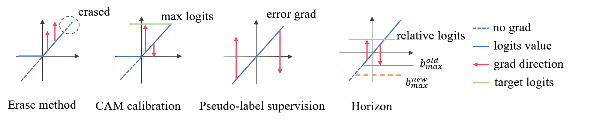
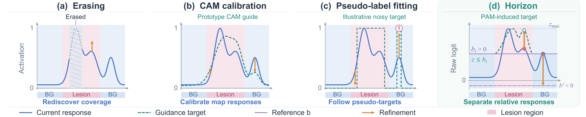

# Horizon

**Resolving Logits Adhesion for Weakly Supervised Intracranial Hemorrhage Segmentation**

Caozhi Shang, Xian Lin, Junjie Shi, Zengqiang Yan, Xianbo Deng, and Li Yu

Horizon learns to localize intracranial hemorrhage on non-contrast head CT using a binary label for each training slice. A classifier can correctly identify a positive slice while assigning similar scores to a subtle bleed and nearby normal tissue. The manuscript calls this overlap between their pixel-wise logit distributions **logits adhesion**. Horizon uses the feature distributions of hemorrhage and normal tissue to teach the classifier which local responses to raise or suppress.

This PyTorch release includes Horizon with SPOL and Swin-MIL backbones, both standalone baselines, an RSNA training entry point, and slice-level inference for INSTANCE and BHSD.

## How Horizon works

Horizon fits a Gaussian mixture model (GMM) to each class and samples prototypes that represent hemorrhage and background tissue. Their similarities to each image location form a prototype activation map (PAM). During training, the PAM guides the classifier across two views of the same slice. At inference, the classifier activation map localizes hemorrhage.


The relative activation map (RAM) uses the strongest background logit as a reference. A lesion pixel can therefore have positive relative activation even when its raw logit is negative.





## Results reported in the manuscript

Table 2 reports patient-volume Dice as mean ± standard deviation over four independent runs. The Logits Adhesion Index (LAI) measures the overlap of hemorrhage and normal-tissue logit densities. Lower LAI indicates better separation. The segmentation threshold was selected on held-out INSTANCE validation data and then fixed for testing.

| Model | CLI name | INSTANCE Dice ↑ (%) | INSTANCE LAI ↓ (%) | BHSD Dice ↑ (%) | BHSD LAI ↓ (%) |
| --- | --- | ---: | ---: | ---: | ---: |
| SPOL | `spol` | 49.90 ± 3.33 | 11.58 | 29.68 ± 2.37 | 27.86 |
| Horizon (SPOL) | `horizon_spol` | 59.56 ± 1.36 | 7.52 | 39.55 ± 0.59 | 23.38 |
| Swin-MIL | `swin_mil` | 56.53 ± 2.76 | 8.48 | 35.80 ± 1.58 | 17.93 |
| Horizon (Swin-MIL) | `horizon_swin` | 63.79 ± 0.32 | 4.26 | 43.43 ± 0.18 | 14.38 |

## Horizon-SPOL weights

The release includes the Horizon-SPOL weights at `weights/horizon_spol_weights.pth` (100.67 MiB). This PyTorch state dictionary contains the learned parameters and fitted prototype bank.

## Test Horizon-SPOL on ten positive INSTANCE slices

1. From the repository root, install the dependencies in a Python 3.9 environment.

   ```sh
   python -m pip install -r requirements.txt
   ```

2. The [joytest manifest](data/INSTANCE/joytest.txt) lists ten hemorrhage-positive INSTANCE slices from ten patients. The [bundled HDF5 inputs](data/INSTANCE/data/slices/) each contain the CT image and its reference mask (`image` and `label`). The command below reads them directly.

3. Run inference. Use a new output directory for each run.

   ```sh
   python predict.py --model horizon_spol --checkpoint weights/horizon_spol_weights.pth --data-root data/INSTANCE --list joytest.txt --format jpg --output outputs/joytest
   ```

4. Open `outputs/joytest/`. The [published joytest results](results/joytest/) include the ten JPGs and a CSV of slice-level predictions. A complete run produces ten JPGs whose names match the slice IDs. Each image shows the input CT, the reference lesion mask in green and the classifier CAM with the slice logit. The heatmap is normalized to the largest positive CAM response on that slice. This all-positive example checks inference and image export; use the full evaluation split for segmentation metrics.

### Other inference inputs

For a full INSTANCE list, replace `joytest.txt` with your list relative to the data root, for example `val_slices.txt`. For BHSD, pass `--dataset bhsd` and a list of case IDs. Each ID maps to `label_192/vol/<id>_vol.npy` and `label_192/seg/<id>_seg.npy` under the BHSD data root. The loader resizes slices to 240 × 240 and repeats the grayscale channel three times. BHSD inference rotates the CAM back into the mask coordinate frame before export. Use `--format npz` for raw CAMs, case IDs and classification logits.

## Train on RSNA

**1. Prepare the training slices.** Start with preprocessed RSNA 2019 head CT slices. If your slices are already grayscale JPGs, save a PNG copy of each decoded image in `data/RSNA/pngs/` with the same filename stem (e.g., `ID_001.jpg` becomes `ID_001.png`). The training loader looks for `<stem>.png`. Use existing preprocessed PNGs directly.

Split by patient (70% training, 30% classification validation). In `data/RSNA/lists/train.csv`, list only training slices. The first column is the filename stem and the second is 1 if any hemorrhage subtype is present and 0 otherwise.

```csv
Image,any
ID_001,1
ID_002,0
```

**2. Train a model.** From the repository root, install the [requirements](requirements.txt) in a Python 3.9 environment and run:

```sh
python -m pip install -r requirements.txt
python train.py --model horizon_spol --images data/RSNA/pngs --lists data/RSNA/lists --seed 42 --output runs/horizon_spol/seed42
```

Horizon starts from random weights. It trains with AdamW and batches of 48 slices. Each stage begins with two learning-rate warm-up epochs followed by cosine decay.

| Epochs | Training objective | Peak LR | Minimum LR |
| --- | --- | --- | --- |
| 1-10 | Learn slice classification and collect features for the prototype bank | 5e-4 | 5e-5 |
| 11-30 | Train jointly on two views with classification, prototype contrast, consistency and self-distillation | 5e-5 | 1e-5 |

For the other rows of [Table 2](#results-reported-in-the-manuscript), set `--model` to `horizon_swin`, `spol` or `swin_mil`. The two baselines use classification throughout. Give each model and seed its own output directory. The trainer saves `epoch-NNN.pth` after every epoch. To continue the example from epoch 6, add `--resume runs/horizon_spol/seed42/epoch-005.pth`.

**3. Evaluate on the held-out test sets.** For each trained model, select the CAM threshold on a separate segmentation validation split with reference masks. Use the same checkpoint and threshold across all test sets. Follow the [inference input formats](#other-inference-inputs) and export raw spatial logits with `--format npz`.

- **Dice.** Rectify and max-normalize each slice CAM, resize it to the reference mask grid and apply the selected threshold. Suppress predictions on slices with a negative classification logit. Stack the slices in anatomical order and compute Dice per patient, then average across patients within each test set.
- **LAI.** On hemorrhage-positive slices, use the reference masks to collect raw spatial logits for lesion and background locations. Estimate their densities and report the area of overlap as a percentage.
- **Across runs.** Train and evaluate each model with four distinct seeds. For each test set, report the mean and standard deviation of the four run-level Dice scores.
